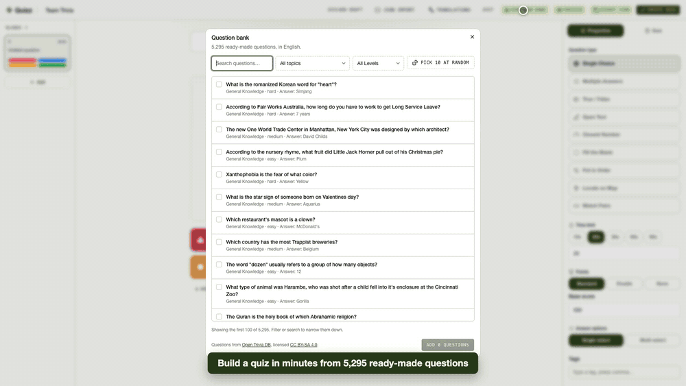
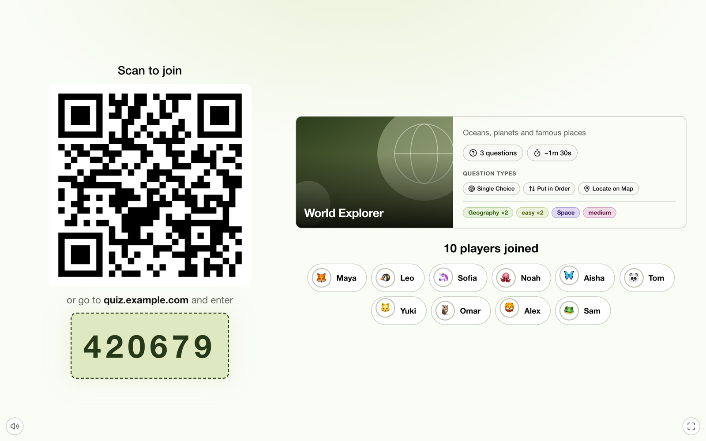
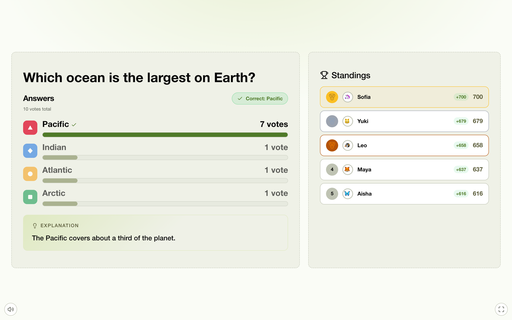
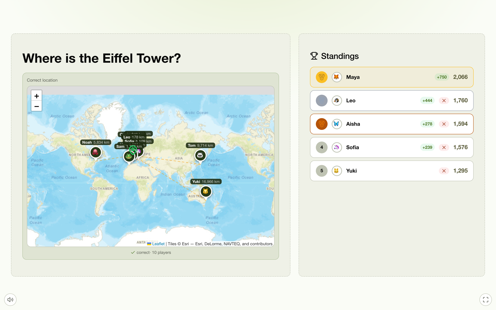
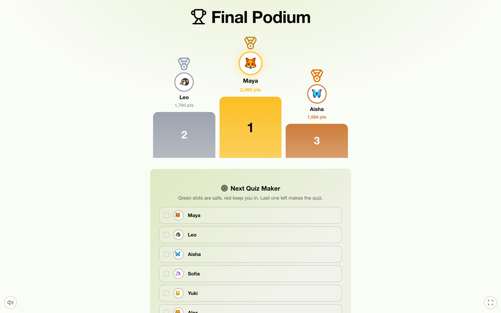
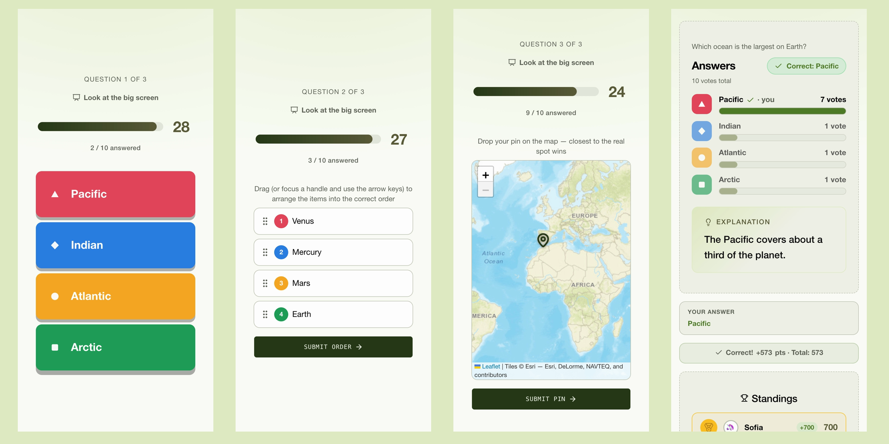
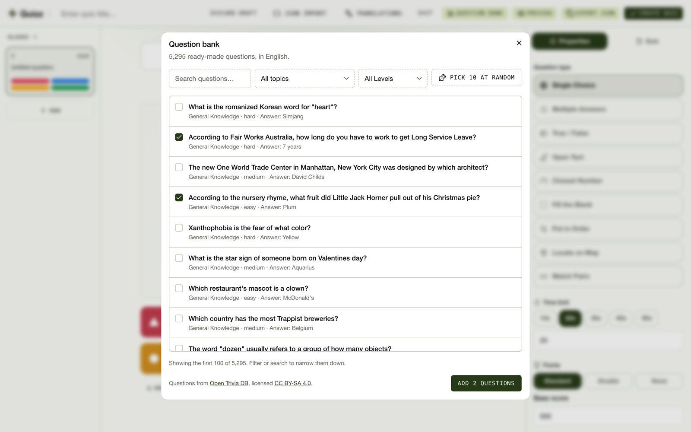
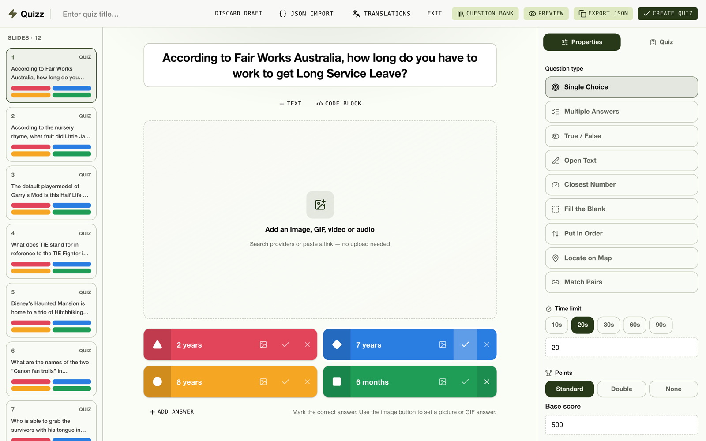
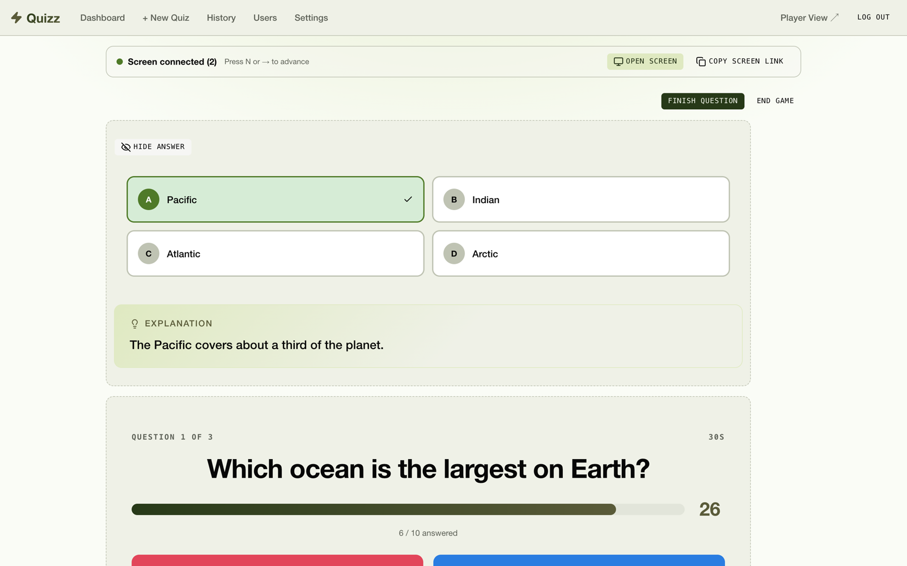
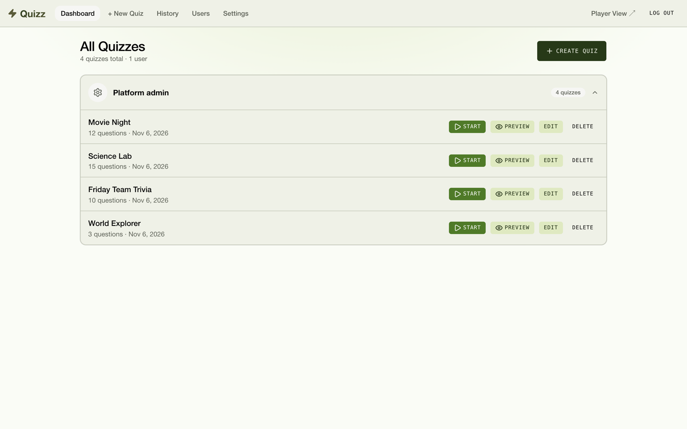

<div align="center">


# Quizz

### Live quizzes on any screen. Self-hosted in minutes.

Put the quiz on a projector or TV. Everyone plays from their phone: no app, no account, just a QR code.

[](LICENSE)
[](https://github.com/Lawndlwd/quizz/pkgs/container/quizz)
[](https://github.com/Lawndlwd/quizz/stargazers)

[**Quick start**](#quick-start) · [**Features**](#features) · [**Full demo video**](.github/media/demo.mp4) · [**Generate quizzes with AI**](#generate-quizzes-with-ai)



</div>

## Why Quizz

| | |
|---|---|
| **Yours** | Your server, your data. No accounts for players, no per-seat pricing, MIT licensed. |
| **Small** | One container and a SQLite file. No database server to run. |
| **Made for the room** | A real presentation mode: the big screen shows the game, phones are the controllers, the host keeps the answers private. |
| **Ready to play** | 5,596 ready-made questions built in, including map questions, or let any AI turn a document into a quiz. |
| **More than A/B/C/D** | Nine question types, including sorting, map pins and matching pairs. |

## Quick start

You need Docker and about two minutes.

```sh
mkdir quizz && cd quizz
curl -O https://raw.githubusercontent.com/Lawndlwd/quizz/main/docker-compose.yml

cat > .env <<EOF
ADMIN_PASSWORD=$(openssl rand -base64 18)
JWT_SECRET=$(openssl rand -hex 32)
EOF

docker compose up -d
```

That's it:

- **Host:** `http://your-server:3000/admin`, signing in as `admin` with the password from `.env`
- **Players:** `http://your-server:3000/play`, or scan the QR code in the lobby

So phones can reach your server from the QR code, add its address to `.env`:

```env
PUBLIC_URL=http://192.168.1.20:3000
```

### Add HTTPS

Phones need a real address to join from outside your network. Choose the setup that matches your server.

<details>
<summary><b>A server just for Quizz: use the built-in Caddy</b></summary>

Point your domain's DNS at the server and make sure ports 80 and 443 are free. In your `quizz` folder, download the Caddy config:

```sh
curl -O https://raw.githubusercontent.com/Lawndlwd/quizz/main/Caddyfile
```

Add these to `.env`:

```env
DOMAIN=quiz.example.com
PUBLIC_URL=https://quiz.example.com
APP_BIND=127.0.0.1
```

Then start Quizz with the Caddy profile:

```sh
docker compose --profile caddy up -d
```

Caddy gets and renews the certificate automatically. Keep using `--profile caddy` for later `up` and `down` commands.

</details>

<details>
<summary><b>A server with other apps: use your existing proxy</b></summary>

Skip the Caddy profile and the `Caddyfile`, so Quizz never touches ports 80 or 443. Add these to `.env`, choosing any free port:

```env
APP_PORT=3100
APP_BIND=127.0.0.1
PUBLIC_URL=https://quiz.example.com
```

Start it with `docker compose up -d`, then point your proxy at `127.0.0.1:3100`. If your proxy runs in Docker, `127.0.0.1` means the proxy's own container, so leave out `APP_BIND` and use the server's private IP instead, keeping the port closed to the internet.

Your proxy must allow WebSockets, which the live game uses. Caddy and Traefik do this by default. For nginx:

```nginx
server {
    server_name quiz.example.com;

    location / {
        proxy_pass http://127.0.0.1:3100;
        proxy_http_version 1.1;
        proxy_set_header Upgrade $http_upgrade;
        proxy_set_header Connection "upgrade";
        proxy_set_header Host $host;
        proxy_set_header X-Forwarded-For $proxy_add_x_forwarded_for;
        proxy_set_header X-Forwarded-Proto $scheme;
    }
}
```

</details>

<details>
<summary><b>Options, updates and backups</b></summary>

All settings live in `.env`. See [`.env.example`](.env.example) for details.

| Variable | Purpose |
|---|---|
| `ADMIN_PASSWORD`, `JWT_SECRET` | Required. `JWT_SECRET` needs at least 32 characters. |
| `ADMIN_USERNAME` | Admin login. Defaults to `admin`. |
| `APP_PORT` | Port on your server. Defaults to `3000`. |
| `APP_BIND` | Network address for that port. Use `127.0.0.1` to allow access only through a proxy. |
| `DOMAIN` | Your domain, for the built-in Caddy. |
| `PUBLIC_URL` | Address used in join links and QR codes. Also editable in Settings. |
| `ALLOWED_DOMAIN` | Allow sign-ups from one email domain, such as `mycompany.com`. |
| `UNSPLASH_ACCESS_KEY`, `GIPHY_API_KEY` | Extra image and GIF search in the quiz editor. |

**Update:** `docker compose pull && docker compose up -d`

**Back up:** copy the `data/` and `avatars/` folders next to `docker-compose.yml`.

</details>

## See it in action

### The big screen

<table>
<tr>
<td width="50%"><br /><b>Scan and join.</b> QR code, PIN and players appearing live.</td>
<td width="50%"><br /><b>Instant results.</b> Votes, the right answer, an explanation and live standings.</td>
</tr>
<tr>
<td><br /><b>Map questions.</b> See where every player dropped their pin.</td>
<td><br /><b>A big finish.</b> Podium, confetti and a game to pick the next quiz maker.</td>
</tr>
</table>

### On every phone



### For the host

<table>
<tr>
<td width="50%"><br /><b>Question bank.</b> Filter by topic and level, tick what you like or pick 10 at random.</td>
<td width="50%"><br /><b>Slide-style editor.</b> Images, GIFs, YouTube audio or video, code blocks and more.</td>
</tr>
<tr>
<td><br /><b>Private host controls.</b> The answer key stays on your screen. Press N or → to advance.</td>
<td><br /><b>All your quizzes.</b> Start, preview or edit in a click.</td>
</tr>
</table>

## Features

- **Presentation mode:** a read-only big-screen link, phones as controllers, and host-paced questions
- **Nine question types**, with partial credit where it makes sense
- **Question bank** of 5,596 questions: trivia across 24 topics, plus world capitals, landmarks and natural wonders on the map
- **Scoring** with speed and streak bonuses, plus optional Pass and 50/50 jokers
- **Reconnect-safe:** reloading or switching tabs puts players back in the game
- **Translations** so players can follow a quiz in their own language
- **Accounts:** a super admin plus regular users who host their own quizzes, with optional domain-restricted sign-up
- **History** of past games with every player's answers
- **Custom branding** and bulk-uploaded avatar packs
- **Load-test tool** to check your own server before a big event

## Running a game

1. **Create a quiz** in the editor, from the question bank, or [with your favorite AI](#generate-quizzes-with-ai).
2. **Press Start** and choose the game's settings: presentation mode, jokers, streak bonus and the next quiz maker picker.
3. **Open the screen.** In presentation mode, click **Open screen** and drag that window to your projector or TV, or copy the link to another device.
4. **Players join** by QR code or PIN, with a name and an avatar.
5. **Play.** Each question has a server-side timer and reveals when time runs out or everyone has answered. You can finish a question early, skip ahead or end the game.
6. **Celebrate.** The podium appears with confetti, and a Plinko game can pick who makes the next quiz.

## Question types

| Type | How it works |
|---|---|
| **Single choice** | One correct option out of several. The only type that supports the 50/50 joker. |
| **Multiple answers** | Several correct options — the player must select exactly the right set. |
| **True / False** | Two fixed options. |
| **Open text** | Free text input, matched case- and whitespace-insensitively. |
| **Closest to** | Numeric guess on a slider within a configured range. Exact match scores full points; otherwise partial credit by distance. |
| **Fill in the blank** | Question text with `___` markers; each blank accepts one or more answers. Partial credit per blank matched. |
| **Ordering** | Arrange items in the correct order (items are shuffled per question). Partial credit per item in the right place. |
| **Locate on map** | Drop a pin on a map. Within 50 km counts as correct; beyond that, points decay exponentially with distance. |
| **Match pairs** | Link each item on the left to its match on the right. |

Each question can also have:

- **Base score** and **time limit** (defaults: 500 pts, 20 s)
- **Image**, or **YouTube audio/video** with a start offset (`?t=SECONDS`) — audio plays hidden for music rounds
- **Markdown code blocks** in the question text (great for programming quizzes)
- **Image URLs as answer options** (mixable with text)
- **Explanation** shown after the reveal
- **Tags** (topic, difficulty) aggregated into the lobby intro screen

## Question bank

Click **Question bank** in the quiz editor to add ready-made questions, filtered by topic, level and type. They become normal questions you can edit.

| Questions | Count | Languages | Source | License |
|---|---:|---|---|---|
| Multiple choice and true/false | 5,295 | English | [Open Trivia DB](https://opentdb.com) | [CC BY-SA 4.0](https://creativecommons.org/licenses/by-sa/4.0/) |
| Map: capitals, landmarks and natural wonders | 301 | English, French | Coordinates from [Wikidata](https://www.wikidata.org) | [CC0](https://creativecommons.org/publicdomain/zero/1.0/) |

Map questions use the quiz's language. A few capitals with disputed status are left out.

To refresh the data in `server/assets/`, run `node server/scripts/fetchOpenTdb.mjs` (about 15 minutes) or `node server/scripts/fetchGeoBank.mjs` (under a minute).

## Generate quizzes with AI

You can use **any AI you like** — ChatGPT, Claude, Gemini, Copilot, a local model (Ollama), etc. — to turn a document into a full quiz. No API key or integration is built into Quizz; you bring your own AI and paste the result.

**How it works**

1. In the admin panel, open **Create Quiz** and switch to **Paste JSON**.
2. Click **Copy prompt** (instructions + JSON schema) — or **Copy example** for a full sample quiz JSON. Paste into your AI chat and attach a document or describe a topic (source material is optional).
3. Copy the AI's JSON output, paste it into **Create Quiz → Paste JSON**, click **Apply to studio** to edit as slides (or save directly), then create the quiz from the studio when ready.

The visual editor (**Quiz Studio**) is still there for manual tweaks after import.

**Tips**

- **Any document works** — PDF, Word, slides, web pages, plain text. If upload isn't supported, copy-paste the text instead.
- **Split large docs** — ask for "10 questions on chapter 3" rather than an entire textbook at once.
- **Review before hosting** — AI can misread facts or pick wrong answers; spot-check questions, especially for exams or compliance training.
- **Scanned PDFs** need OCR first (e.g. Google Drive upload, or paste text from another tool).

## More details

<details>
<summary><b>Scoring</b></summary>

- **Base score** — configurable per question (default 500 pts) for a correct answer
- **Speed bonus** — order-based: the first correct answer gets +200, decaying linearly down to +10 for the last
- **Streak bonus** — from the 3rd consecutive correct answer, +50 pts per extra streak level
- **Partial credit** — closest-to, fill-blank, ordering, and map questions award a fraction of the base score; speed/streak bonuses only apply to fully correct answers
- The host can remove a player's points for a specific question during the game

All values (base score, bonus ranges, streak rules) are editable in the admin settings.

</details>

<details>
<summary><b>Admin and accounts</b></summary>

- **Two roles** — super admin and regular users; users only see and host their own quizzes
- **User management** (super admin) — list users, ban/unban, reset passwords, delete
- **Registration** can be restricted to a configured email domain
- **Session history** — past games with per-player answers, force-end running sessions
- **Settings UI** — app name/subtitle, timing, scoring, leaderboard visibility, max players (default 300), auto-advance
- **Avatar packs** — bulk-upload avatar images for players to pick from

</details>

<details>
<summary><b>Load testing</b></summary>

Manual only — not run in CI. Use it before a big event, or after touching
`player:join`/`player:answer`/anything on the DB write path, to see how the
server actually holds up under many concurrent players.

```sh
cd server
pnpm load-test --url http://localhost:3000 \
  --email admin --password <admin password> \
  --players 100 --sessions 1 --questions 5 --time 15
```

Flags: `--players` (bots per session), `--sessions` (concurrent games),
`--questions`, `--time` (seconds/question), `--answer-delay` (max random
pre-answer delay, ms), `--metrics-interval` (ms between live metrics polls),
`--keep` (skip cleanup — leave the generated quiz/sessions in place).

It logs in as admin, creates a throwaway quiz, spins up the bots over real
socket.io connections, plays the game to completion, and prints join/answer
latency percentiles plus a peak event-loop-lag / SQLite-write-latency / memory
summary — then deletes what it created (unless `--keep`).

Live server health during a run — or anytime — is also available directly:
`GET /api/admin/metrics` (super admin token required). Returns event loop
lag, memory, a SQLite write-latency ping, connected socket count, and
active session/player counts. It's a point-in-time snapshot only — nothing
is persisted or graphed.

Numbers are hardware-specific — run it against the box you actually care
about, not a laptop, if the result needs to mean something.

</details>

## Development

Requires Node.js 22 and pnpm.

```sh
cp .env.example .env   # set JWT_SECRET
pnpm install
pnpm dev
```

- App: http://localhost:5173
- Admin: http://localhost:5173/admin. Sign in as `admin` with `ADMIN_PASSWORD`, or with the one-time password printed in the server logs if it's unset.

Built with React, TypeScript, Vite, Express, Socket.IO and SQLite. See [CONTRIBUTING.md](CONTRIBUTING.md) to get involved.

## License

[MIT](LICENSE). Trivia in the question bank is [CC BY-SA 4.0](https://creativecommons.org/licenses/by-sa/4.0/), from [Open Trivia DB](https://opentdb.com). Map coordinates are [CC0](https://creativecommons.org/publicdomain/zero/1.0/), from [Wikidata](https://www.wikidata.org).
